

  

  


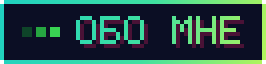

Привет! Я **Екатерина**, мне 24, и я пишу код, который превращается в продукты: от AI-платформ до маленьких пиксельных миров ✨

- 🎓 диплом по специальности **«Информационные технологии и программирование»**
- 💻 в разработке с **2020 года**: начинала с фриланса, с 2022-го работаю в командах
- 🛠️ пишу на **TypeScript**, **C#** и **Python**, фронтенд и бэкенд
- 🧠 люблю задачи на стыке ИИ и бизнеса: RAG, базы знаний, автоматизация и оцифровка процессов
- 🚀 свои проекты сама довожу до продакшена
- 🎮 для души: игры, сюжеты и пиксель-арт
- 🐾 а ещё я **зооволонтёр**: когда не пишу код, помогаю животным

 

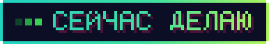

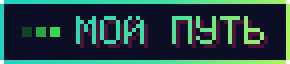


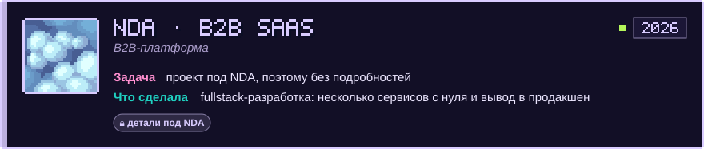

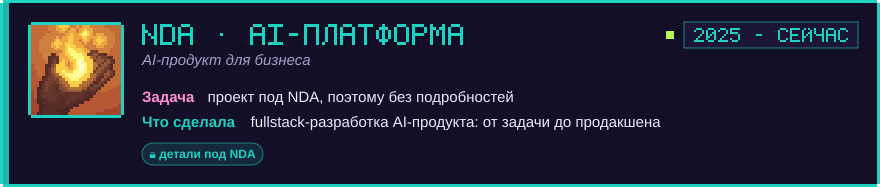

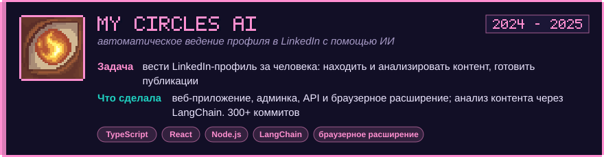

<b>Раньше: Localie и фриланс</b> (нажми, чтобы развернуть)

 

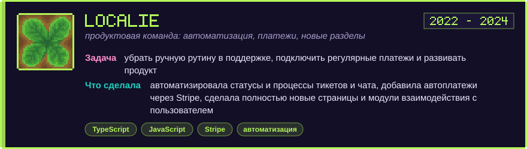

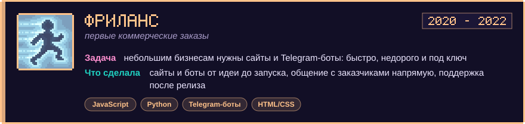

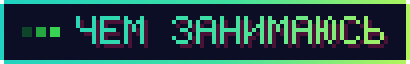

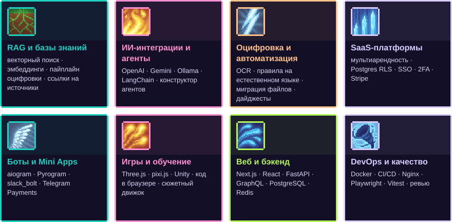

<b>Подробнее о каждом направлении</b>

#### 🧠 RAG и базы знаний
векторный поиск на Qdrant и pgvector (HNSW), эмбеддинги · пайплайн оцифровки extract → chunk → embed → store · ответы со ссылками на источники и права доступа на поиске · импорт из облачных хранилищ, чатов и webhook-источников

#### 🤖 ИИ-интеграции и агенты
LLM через OpenAI SDK, OpenRouter, Gemini и локально через Ollama · конструктор агентов и workflow, LangChain · маршрутизация сценариев диалога силами модели · Whisper для голосовых, перевод, структурированные JSON-ответы

#### 📄 Оцифровка и автоматизация
AI-документооборот: OCR, оценка уверенности, правила на естественном языке · миграция файлов между облачными хранилищами · Google Sheets как база для небольших бизнесов · автоматические дайджесты релизов

#### 🏢 SaaS-платформы
мультиарендность: Supabase, Postgres RLS, edge-функции · SSO, 2FA, RBAC, лимиты расходов на ИИ · интеграции через OAuth · оплаты через Stripe, email-уведомления

#### 💬 Боты и Mini Apps
Telegram: aiogram, python-telegram-bot, Pyrogram · Slack-боты на slack_bolt · Telegram Payments, Mini Apps, задачи по расписанию · управление участниками сразу во многих чатах

#### 🎮 Игры и обучение
Three.js / React Three Fiber, pixi.js, Unity и C# · онлайн-мультиплеер на GraphQL-подписках · ИИ-ведущий и сюжетный движок · запуск кода в браузере: Monaco, Sandpack, QuickJS, sql.js

#### 🌐 Веб и бэкенд
Next.js, React, Vite, Tailwind, shadcn/ui, HeroUI · Express, GraphQL, FastAPI, Flask, BullMQ · PostgreSQL, MongoDB, Redis, SQLite, Prisma · монорепозитории, браузерные расширения

#### 🚀 DevOps и качество
Docker, Hetzner, VPS, Nginx, Caddy, Kong, Dokku · CI/CD в GitHub Actions, выкат stage → прод · тесты на Playwright и Vitest · ревью кода и релизы в команде

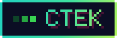

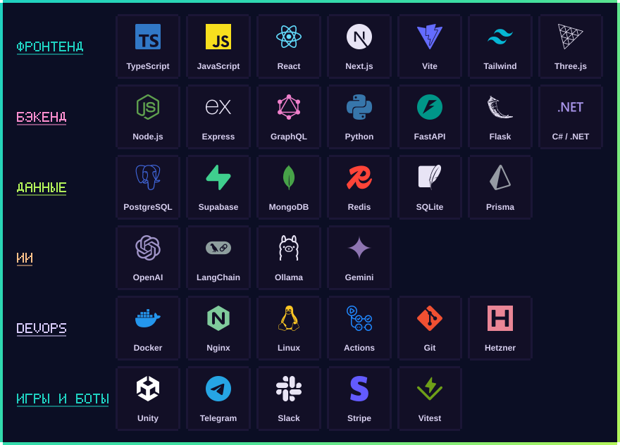

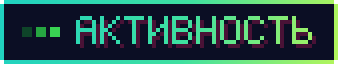


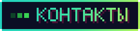

  <a href="https://t.me/RinBoro">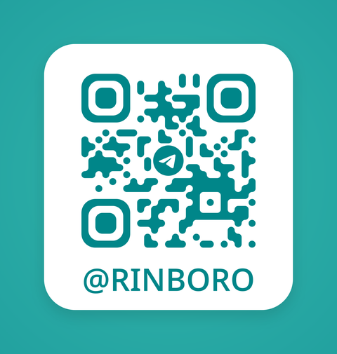</a>
   
  пиши в Telegram: <a href="https://t.me/RinBoro"><b>@RinBoro</b></a>

